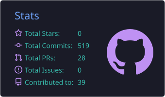
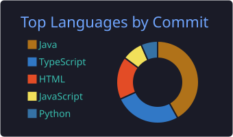
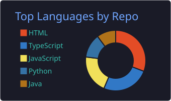
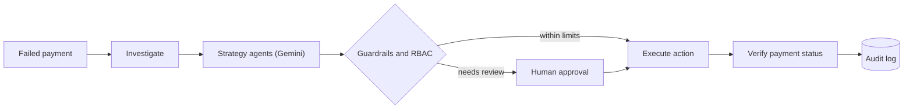
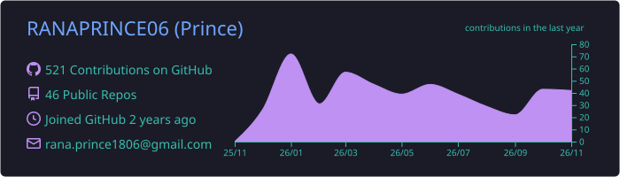
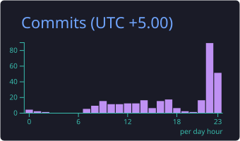
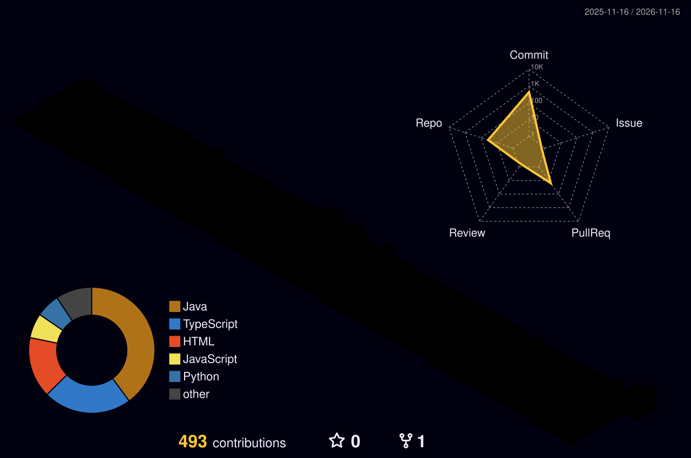

 

  

  

**BUILD · SOLVE · SHIP · IMPROVE**

I build backend systems and AI-powered applications, with a strong foundation in problem-solving and full-stack development.

<a href="#snapshot">Snapshot</a> ·
<a href="#tech">Tech</a> ·
<a href="#projects">Projects</a> ·
<a href="#experience">Experience</a> ·
<a href="#cp">Competitive</a> ·
<a href="#analytics">Analytics</a> ·
<a href="#hackathons">Hackathons</a> ·
<a href="#certs">Certifications</a> ·
<a href="#contact">Contact</a>

## ◈ 01 — Developer Snapshot

<table>
<tr>
<td width="55%" valign="top">

### Hey, I'm Prince 👋

I'm pursuing a B.Tech in Computer Science & Engineering (Artificial Intelligence) at Parul University. I enjoy building practical applications where backend engineering, clean APIs, databases, and AI workflows come together.

- 🎓 **Education:** B.Tech CSE (AI), 2024–2028
- 📈 **CGPA:** 7.96 / 10
- 🧩 **Problem solving:** 1,500+ DSA problems solved across platforms
- ☁️ **Cloud:** Google Cloud Arcade Legend
- 🏅 **Competition:** Runner-Up — PUCC ICPC-Style Programming Contest
- 💼 **Experience:** Frontend Developer Intern at QSkill; AI Intern at Codec Technologies India
- 🎯 **Current interests:** Backend engineering, system design, and reliable AI applications

</td>
<td width="45%" valign="top">

</td>
</tr>
</table>

### 🔭 Right now

| Focus | What I'm doing |
|---|---|
| ⚙️ Backend | Clean APIs, databases, guardrails, and testing |
| 🤖 AI | Reliable multi-agent workflows with human-in-the-loop controls |
| 🏗️ System design | Idempotency, auditability, and failure-safe flows |
| 🧠 DSA | Consistent problem solving on LeetCode, Codeforces and CodeChef |

## ◈ 02 — Tech Universe

<table>
<tr>
<td width="33%" valign="top">

**01 — Languages**

- Java
- Python
- C++
- JavaScript
- SQL

</td>
<td width="33%" valign="top">

**02 — Application Development**

- FastAPI
- Node.js & Express.js
- Django
- React.js
- HTML & CSS
- REST APIs / JSON

</td>
<td width="33%" valign="top">

**03 — Data & Infrastructure**

- MySQL, MongoDB, Oracle DB
- Docker & Kubernetes
- Google Cloud Platform
- Oracle Cloud Infrastructure
- Git, GitHub & Postman

</td>
</tr>
</table>

## ◈ 03 — Featured Builds

<table>
<tr>
<td width="50%" valign="top">

### 💳 PayRecover AI
*Autonomous Revenue Recovery Agent*

An AI-assisted payment recovery platform that investigates failed payments, recommends recovery strategies, and executes controlled actions.

- Multi-agent strategy generation with Gemini
- Financial guardrails, RBAC, idempotency, audit logs, and human approval
- Razorpay Test Mode integration and payment-status verification
- Resume validation result: 132/132 backend tests passing

</td>
<td width="50%" valign="top">

### 🚧 RoadWatch AI
*AI-Assisted Road Safety Platform*

A road-hazard reporting platform that helps classify road damage and organize reporting and repair workflows.

- Gemini REST API integration for road-damage classification
- Structured JSON request/response flows
- Reusable UI components and API-driven data updates

[↗ View Repository](https://github.com/RANAPRINCE06?tab=repositories)

</td>
</tr>
<tr>
<td width="50%" valign="top">

### 🏟️ StadiumX
*Sports Venue Booking Platform*

A responsive platform for sports venue discovery, booking, and scheduling.

- Modular and reusable UI components
- REST API integration for booking and user data
- Routing and state management for booking workflows

[↗ View Repository](https://github.com/RANAPRINCE06?tab=repositories)

</td>
<td width="50%" valign="top">

### 🛡️ GigShield AI
*Parametric Microinsurance Concept*

A hackathon project concept focused on parametric microinsurance for gig-economy workers.

- Explored AI-assisted claims and fraud-verification workflows
- Built as part of Guidewire DEVTrails 2026
- Participated as Team Leader

</td>
</tr>
</table>

Other hackathon work: <b>Traveloop</b> — travel planning · <b>TraceLock</b> — Google Solution Challenge 2026

<b>🧭 PayRecover AI — high-level flow</b>

 

## ◈ 04 — Engineering Experience

<table>
<tr>
<td width="50%" valign="top">

### Frontend Developer Intern
**QSkill** · Remote
*June 2026 — July 2026*

- Developed responsive interfaces using React.js, Tailwind CSS, and Bootstrap
- Integrated REST APIs for dynamic data
- Built reusable components and improved cross-device responsiveness
- Used Git and GitHub for version control

</td>
<td width="50%" valign="top">

### Artificial Intelligence Intern
**Codec Technologies India** · Remote
*June 2026 — July 2026*

- Developed Python-based AI applications
- Processed structured datasets for predictive workflows
- Integrated Generative AI APIs into application logic
- Collaborated on scalable application functionality

</td>
</tr>
</table>

## ◈ 05 — Competitive Programming Arena

| Platform | Highlight |
|---|---|
| LeetCode | Knight; 1,500+ problems solved across platforms; 17 badges reported on resume |
| Codeforces | Specialist |
| CodeChef | 3-star |
| HackerRank | 5-star in Java & C++ |
| PUCC | Runner-Up — ICPC-Style Programming Contest |

## ◈ 06 — GitHub Analytics Lab

 

### 🐍 Contribution Snake

<picture>
  <source media="(prefers-color-scheme: dark)" srcset="https://raw.githubusercontent.com/RANAPRINCE06/RANAPRINCE06/output/github-contribution-grid-snake-dark.svg" />
  <source media="(prefers-color-scheme: light)" srcset="https://raw.githubusercontent.com/RANAPRINCE06/RANAPRINCE06/output/github-contribution-grid-snake.svg" />
  
</picture>

### 🌌 3D Contribution Landscape

## ◈ 07 — Hackathons & Leadership

| Event | Project | Role |
|---|---|---|
| Guidewire DEVTrails 2026 | GigShield AI | Team Leader |
| Odoo × Parul University 2026 | Traveloop | Team Leader |
| IIT Madras CoERS Road Safety Hackathon 2026 | RoadWatch AI | Team Leader |
| Google Solution Challenge 2026 — Hack2Skills | TraceLock | Participant |

## ◈ 08 — Virtual Job Simulations

<b>Explore completed simulations</b>

 

| Organization | Work explored |
|---|---|
| New York Jobs CEO Council | Fixed Python billing-system defects and worked on invoice features |
| Wells Fargo | Modeled data entities and ER diagrams for a portfolio management system |
| Walmart USA | Explored system design and relational database schema optimization |
| J.P. Morgan | Worked with REST APIs and simulated Kafka-based event-driven systems |
| Deloitte Australia | Analyzed datasets with Python and created dashboards |
| AWS Solutions Architecture | Designed cloud architectures using EC2, S3, and IAM |

## ◈ 09 — Certifications & Learning

<b>View certification list</b>

 

- Google Cloud Arcade — Legend Tier
- Oracle Cloud Infrastructure Foundations Associate
- Oracle Cloud Infrastructure AI Foundations Associate
- AWS Academy Graduate — Cloud Foundations
- Google Cloud Gen AI Academy APAC Edition — Cohort 2
- Gemini Certified University Student
- IBM Python Specialist
- IBM Statistics 101
- Generative AI Foundations — Skillsoft
- Introduction to Machine Learning Concepts — Microsoft
- JavaScript IT Specialist — Pearson
- TCS iON — YUVA AI for All
- GDG Build with AI — PromptWars Virtual Challenges 1 & 2
- HTML/CSS Project — Infosys

## ◈ 10 — Education & Foundations

**Parul University**
B.Tech — Computer Science & Engineering (Artificial Intelligence) · 2024–2028
**CGPA:** 7.96 / 10

**Relevant coursework:** Data Structures & Algorithms · Object-Oriented Programming · Database Management Systems · Operating Systems · Computer Networks

### LET'S BUILD SOMETHING THAT MATTERS.

Open to software engineering internships, open-source collaboration, and hackathons.

<a href="https://www.linkedin.com/in/prince-rana-0b622b32a">LinkedIn</a> ·
<a href="https://github.com/RANAPRINCE06">GitHub</a> ·
<a href="https://ranaprince06.github.io/My-Portfolio/">Portfolio</a> ·
<a href="mailto:rana.prince1806@gmail.com">Email</a>

Designed with curiosity, built with consistency.

